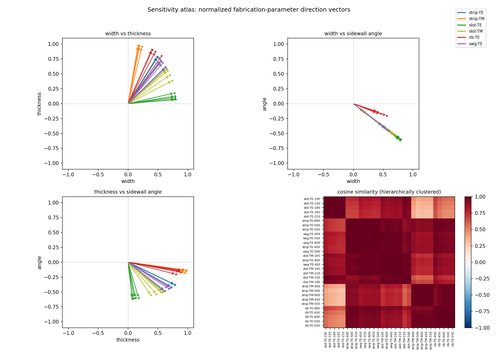
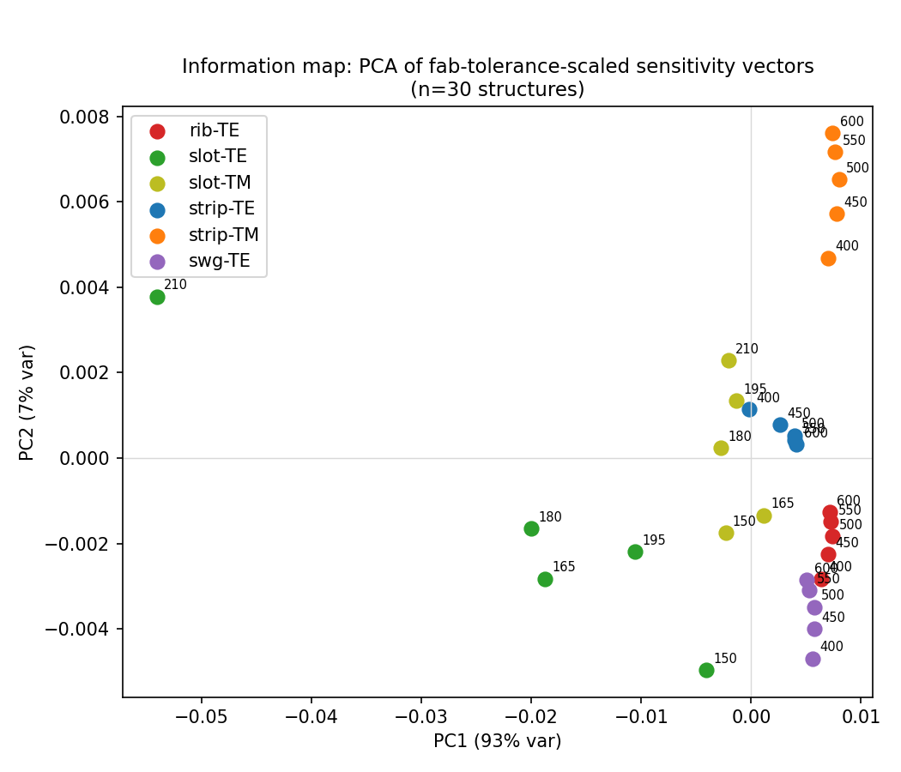
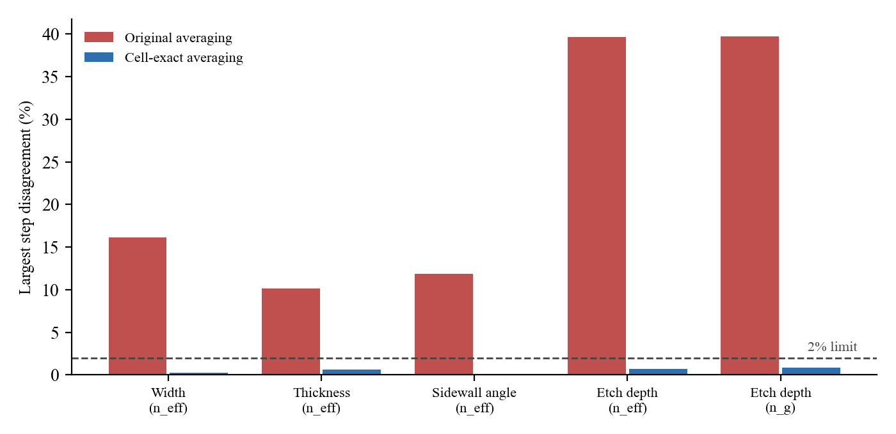

# Measuring sidewall angle optically with test structures

## What the project is about

Silicon photonic chips are very sensitive to small fabrication errors. A few
nanometers of error in waveguide width or thickness, or a degree or two of
sidewall tilt, noticeably shifts how a device behaves. Foundries keep track of
this by putting test structures on the wafer (ring resonators, Mach-Zehnder
interferometers, plain waveguides) and measuring them optically after
fabrication. Width and thickness can be pulled out of these measurements
fairly well. Sidewall angle is much harder, and in practice people usually
fall back on cutting the wafer and looking at it in an SEM, which is slow and
destroys the sample.

This isn't just my impression. Sidewall angle varies across a wafer because
of etch loading, one photonic-crystal cavity study traced lower than expected
Q-factors to non-vertical sidewalls, and a 2023 compact-modeling paper found
that its optical extraction fit was essentially flat across sidewall angles
from 85° to 90°, meaning the measurements could not tell those angles apart.

The test structures in use today are picked by experience, not by any formal
measure of how much they actually tell you. My idea was to treat this as an
experiment-design problem: for a given set of test structures, work out how
well width, thickness and sidewall angle could in principle be recovered, and
then look for structures that improve that, especially for sidewall angle.

## How I did it

For each candidate structure I solved for the optical mode of the waveguide
cross-section with a full-vector finite-difference mode solver (EMpy). I
then nudged the width, thickness and sidewall angle by small amounts (5 nm,
2 nm and 1°) and recorded how the effective index and group index changed.
Those derivatives show how strongly each measurement responds to each
fabrication parameter.

I combined the derivatives with an assumed measurement noise level for each
readout (a ring gives an effective index and a group index, an MZI gives a
phase) to build a Fisher information matrix. Inverting it gives the best
precision any extraction could achieve for each parameter (the Cramér-Rao
bound). Comparing that number across different sets of structures shows which
structures actually add information instead of repeating what is already
there.

The solver was checked against published values for the standard
500 x 220 nm silicon waveguide (effective index about 2.44), against an
independent effective-index calculation I wrote myself, and against
limiting cases (a rib with zero slab should reproduce a strip exactly, which
it does). Structures covered: strip waveguides (TE and TM), slot waveguides
(TE and TM), rib waveguides (TE) and a subwavelength grating (TE), each at
five widths, giving 30 structures in total.

## What I originally found

### Rings alone don't do it

Two TE rings of different widths were badly conditioned for recovering all
three parameters together, with condition numbers between 2.4e5 and 7.3e9.
Sidewall angle sensitivity barely changes from one ring width to the next, so
its effect looks almost the same as a mix of width and thickness changes. The
choice of ring widths still mattered a lot: the condition number varied about
30,000x between the best and worst pair.

### The condition number was the wrong yardstick

At first, adding TM rings or MZIs seemed to make things worse, because the
condition number went up. Looking at the smallest eigenvalue of the Fisher
matrix instead (which is what actually limits the worst-determined parameter)
showed that every added structure helped, and the MZI helped the most. After
this I used the smallest eigenvalue and the trace of the inverse as the main
metrics.

| Added to the best TE ring pair (550 + 600 nm) | Smallest eigenvalue | Condition number |
|---|---|---|
| Nothing (baseline) | 6.33 | 2.4e5 |
| Another TE ring (400 nm) | 7.64 | 3.0e5 |
| TM ring (400 nm) | 6.96 | 3.6e5 |
| MZI (600 nm, TE) | 10.21 | 6.6e5 |

One catch with MZIs: at the same width and polarization as a ring, the MZI
phase is just a scaled copy of the ring's effective-index measurement, so it
only adds something when paired with a different width or polarization.

### Different structures point in different directions, but that alone isn't enough

I turned each structure's derivatives into a direction in
(width, thickness, angle) space and compared them (Figure 1). Structures of
the same type at different widths are nearly parallel (mean angle between them
about 4°), while different types are clearly separated (mean about 46°), and
the structures cluster cleanly by type.

The surprise was that looking different didn't predict being useful. The angle
between two structures' directions actually correlated with the wrong sign
against the Fisher result (Spearman -0.37 against the smallest eigenvalue).
What mattered was how much each structure on its own pointed along the
sidewall-angle axis. Slot TE had the largest angle component of the early
structures (-0.60 to -0.62), which is why it helped. Adding group-index
information to the direction vectors didn't change this.

### Existing structures sit in a small corner of the space

A principal component analysis of the direction vectors showed they collapse
onto an almost flat two-dimensional sheet (Figure 2). For the first 15
structures (strip and slot), the first two components held 95.3% and 4.7% of
the variance, and the third only 0.009%. Adding the rib later raised the third
component to about 0.1%, which is the rib moving toward the gap without
closing it.
That third direction, mostly a mix of width and sidewall angle (loadings
-0.60, 0.03, -0.80), was essentially empty. No strip, TM or slot structure
reached it. I checked that this wasn't caused by how I scaled the three
parameters: across seven different scalings, including none at all, the third
component stayed below 0.01%.

### Slot waveguides helped, but less than they first appeared to

Adding slot waveguides to a strip-only set improved the smallest eigenvalue a
lot when I assumed slot rings measure as precisely as strip rings. Slot
waveguides are known to be lossier, and two same-process comparisons put
their loss at about 3.5 to 5 times that of strip (Baehr-Jones et al., Opt.
Express 19, 11529 and 19, 26275, 2011). With a 4x noise penalty the gain
dropped to about 7x. A slot TM mode turned out to point in nearly the same
direction as an ordinary strip TE mode (about 2° apart), so it added very
little.

| Slot noise compared to strip | Improvement in smallest eigenvalue |
|---|---|
| Same (unsourced) | 90.8x |
| 4x worse (sourced) | 7.1x |
| 10x worse | 2.1x |

### Rib waveguides were the strongest result

A rib (a partially etched waveguide sitting on a thin silicon slab, 90 nm in
my model) pointed much further into the empty direction than anything else
I tried. Its projection onto that direction was 0.087 to 0.154, against 0.018
to 0.031 for strip, slot and the subwavelength grating. Adding five rib widths
to the strip set improved the smallest eigenvalue about 570x. Rib derivatives
were actually smaller in magnitude than strip ones, so the gain came from
pointing in a new direction, not from simply being more sensitive. The
subwavelength grating, modeled as a uniform effective medium, added nothing
(1.1x) and served as a useful negative control.

I checked the rib solver further before trusting this. My own effective-index
calculation gave 2.6033 for the 500 nm rib, against 2.602 from a published
calculation of the same geometry, and the full solver sits 1.2 to 2.4% below
the effective-index value, the same pattern I see for strip. The mesh was
also converged to within 0.64% down to 200 nm wide ribs. For noise, one
same-study comparison found rib loss about 0.2 times strip loss, though for a
wider rib than mine, so I bracketed rib noise between 0.2x and 1.0x of strip.
That gives an improvement of 571.7x (conservative) to about 4000x
(optimistic), so unlike slot, the rib result did not shrink under realistic
noise.

### The sidewall-angle precision itself

The real question is about sidewall angle, not the blended worst case, so I
also computed the Cramér-Rao bound on angle alone, after accounting for width
and thickness being unknown too.

| Structure set | Angle precision (1 sigma) | Improvement |
|---|---|---|
| Strip baseline (5 widths, ring + MZI) | 0.0210° | |
| + rib, conservative noise | 0.0009° | 23x |
| + rib, optimistic noise | 0.0004° | 51x |
| + slot, sourced noise | 0.0081° | 2.6x |

With only two strip rings the angle precision was 0.188°. Interestingly, the
worst-determined direction in that case was mostly width (component -0.92),
not angle (-0.37), which explains why the condition number looked so bad even
though angle by itself was not hopeless. Adding a single rib to those two rings
improved angle precision 11 to 14x, against 1.9x for a slot and 2.0x for a
third strip ring, so the rib advantage held even with very few structures.

### Slab thickness matters

The rib benefit depended on the slab thickness. It never went away, but it
meant the rib should be treated as a family of designs rather than one fixed
recipe.

| Slab thickness | Improvement in smallest eigenvalue |
|---|---|
| 50 nm | 789x |
| 70 nm | 961x |
| 90 nm | 834x |
| 110 nm | 585x |
| 130 nm | 352x |
| 150 nm | 182x |

All of these numbers come from a linearized bound with assumed noise levels.
They describe the best case, not what a real fitting procedure would get. Even
strip alone gives sub-0.1° angle precision on paper, which a real extraction
clearly does not achieve, so the relative ranking (rib well ahead of slot for
sidewall angle) was the part I trusted most.

## The follow-up check, and why it was stopped

The rib result had one obvious weak point. The slab thickness was fixed at
90 nm and treated as perfectly known. In a real process the partial etch depth
varies from wafer to wafer, and the partial etch may not leave the same
sidewall angle as the full etch. If those extra unknowns soak up the
information the rib was providing, the rib advantage could be much smaller
than it looked. I set up a follow-up study to add etch depth (and optionally
a separate sidewall angle for the partial etch) as unknowns and redo the
analysis. The new code is in `src/etch_depth_*.py` and its outputs are in
`results_etch_depth/`.

While setting this up I also noticed that the code's nominal sidewall is
vertical (90°), not 85°, and that the ring noise levels are placeholders
without a source. The effective-index noise of 6.5e-6 matches a 10 pm
resonance precision only if the group index is ignored; including it gives
about 2.6e-5, so that value may be about 4x optimistic.

Before running the Fisher analysis I checked that the new derivatives were
stable, by computing each one with three step sizes (h/2, h and 2h) and
requiring them to agree within 2%. They didn't. Only 34 of 240 entries passed,
and the etch-depth derivatives disagreed by 36 to 41% at every rib.

I traced this to how the existing code builds the material map on the mesh.
Where a grid cell straddles a silicon/oxide boundary, the code averages the
material over a window equal to the average grid spacing of the whole grid
(about 43 x 37 nm), not the actual size of that cell (about 27 x 20 nm near the
waveguide). As a result, moving a boundary by 1 nm doesn't add 1 nm worth of
silicon to the model. Depending on where the boundary sits relative to the
grid, it adds anywhere from about 0.5 to 1.25 nm. All of the slab thicknesses
I used happen to sit at spots where the response is about half what it
should be. When I rebuilt one rib using each cell's true size, silicon was
conserved exactly and the derivatives agreed across step sizes to within 1%
(Figure 3).

This affects more than the new study. With the averaging fixed, the rib
derivatives change by different amounts:

| Derivative of effective index (500 nm rib) | Original | Corrected | Change |
|---|---|---|---|
| Sidewall angle | -9.34e-4 | -1.524e-3 | +63% |
| Etch depth | -1.07e-3 | -1.640e-3 | +53% |
| Width | 5.59e-4 | 8.29e-4 | +48% |
| Thickness | 4.20e-3 | 4.45e-3 | +6% |

Because each parameter is off by a different amount, the direction of each
structure's sensitivity changes, and the rib result was specifically about
direction. The strip derivatives go through the same code. So the earlier
numbers above, including the rib gains and the empty direction in Figure 2,
need to be recomputed with corrected averaging before they can be relied on.
One small group-index derivative (with respect to thickness) was still
unstable after the fix, because its value is close to zero, and needs a
separate check.

I stopped there rather than run the Fisher analysis on numbers I already
knew were off. Before continuing, three choices are needed: whether to fix the
averaging in the existing code or build corrected versions alongside it, how
to judge derivatives that are close to zero, and whether to keep the nominal
sidewall at 90° or move to 85°. The detailed numbers are in
`results_etch_depth/STOP_REPORT.md`.
