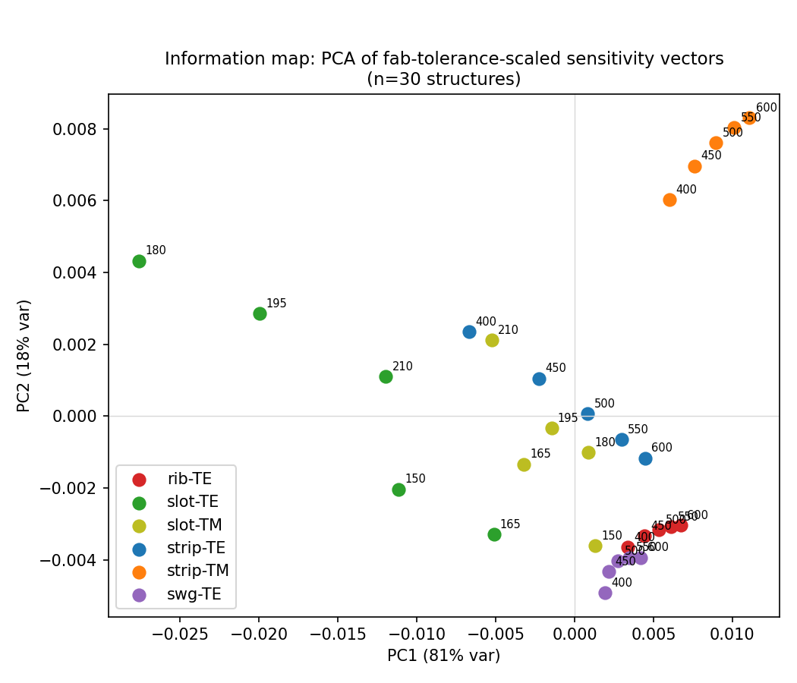
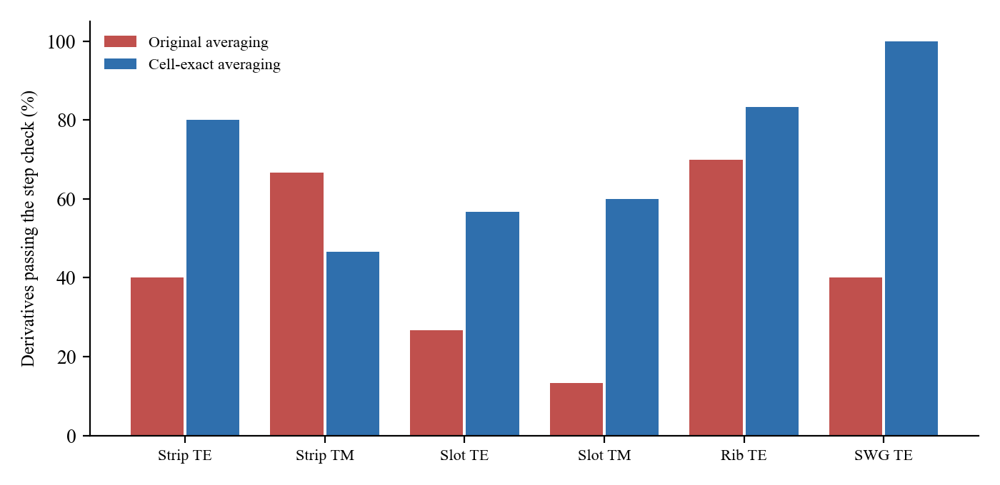

# Measuring sidewall angle optically with test structures

## What the project is about

Silicon photonic chips are very sensitive to small fabrication errors. A few
nanometers of error in waveguide width or thickness, or a degree or two of
sidewall tilt, noticeably shifts how a device behaves. Foundries keep track of
this by putting test structures on the wafer (ring resonators, Mach-Zehnder
interferometers, plain waveguides) and measuring them optically after
fabrication. Width and thickness can be pulled out of these measurements
fairly well. Sidewall angle is much harder, and in practice people usually
fall back on cutting the wafer and looking at it in an SEM, which is slow and
destroys the sample.

This isn't just my impression. Sidewall angle varies across a wafer because
of etch loading, one photonic-crystal cavity study traced lower than expected
Q-factors to non-vertical sidewalls, and a 2023 compact-modeling paper found
that its optical extraction fit was essentially flat across sidewall angles
from 85° to 90°, meaning the measurements could not tell those angles apart.

The test structures in use today are picked by experience, not by any formal
measure of how much they actually tell you. My idea was to treat this as an
experiment-design problem: for a given set of test structures, work out how
well width, thickness and sidewall angle could in principle be recovered, and
then look for structures that improve that, especially for sidewall angle.

## How I did it

For each candidate structure I solved for the optical mode of the waveguide
cross-section with a full-vector finite-difference mode solver (EMpy). I
then nudged the width, thickness and sidewall angle by small amounts (5 nm,
2 nm and 1°) and recorded how the effective index and group index changed.
Those derivatives show how strongly each measurement responds to each
fabrication parameter. Every derivative was also computed with half and
double those steps to check that it doesn't depend on the step size.

I combined the derivatives with an assumed measurement noise level for each
readout (a ring gives an effective index and a group index, an MZI gives a
phase) to build a Fisher information matrix. Inverting it gives the best
precision any extraction could achieve for each parameter (the Cramér-Rao
bound). Comparing that number across different sets of structures shows which
structures actually add information instead of repeating what is already
there.

All results below use corrected material averaging on the mesh (see the last
section). The solver was checked against published values for the standard
500 x 220 nm silicon waveguide (effective index 2.454, against about 2.44 to
2.45 in the literature), against an independent effective-index calculation I
wrote myself, and against limiting cases (a rib with zero slab reproduces a
strip exactly, to 4e-16). Structures covered: strip waveguides (TE and TM),
slot waveguides (TE and TM), rib waveguides (TE) and a subwavelength grating
(TE), each at five widths, giving 30 structures in total. The nominal
sidewall is vertical (90°).

## What I found

### Rings alone don't do it

Two TE rings of different widths were very badly conditioned for recovering
all three parameters together, with condition numbers between 9.7e9 and
3.1e10. The reason turned out to be more basic than I first thought (see
"Why most structures can't see sidewall angle" below): for a strip, tilting
the sidewall looks almost exactly like making the waveguide narrower. With the
corrected derivatives, the choice of ring widths hardly matters any more: the
condition number varies only 3.1x between the best and worst pair, because
every pair is close to singular.

### The condition number was the wrong yardstick, but no addition fixes it

The smallest eigenvalue of the Fisher matrix (which limits the
worst-determined parameter) and the trace of its inverse are better
measures than the condition number, because adding a measurement can only
increase information, yet the condition number can still get worse. That
still happens here for another TE ring and for the MZI.

| Added to the best TE ring pair (550 + 600 nm) | Smallest eigenvalue | Condition number |
|---|---|---|
| Nothing (baseline) | 1.4e-4 | 9.7e9 |
| Another TE ring (500 nm) | 2.4e-4 | 1.0e10 |
| TM ring (400 nm) | 7.8e-3 | 3.7e8 |
| MZI (600 nm, TE) | 1.4e-4 | 3.9e10 |

This reverses part of what I found before. The MZI now adds essentially
nothing, and the TM ring is the addition that helps most, improving both the
smallest eigenvalue and the condition number. None of the additions makes the
problem well conditioned, and these baseline eigenvalues are so small that
their exact values depend on the finite-difference step (the 550 + 600 nm
baseline ranges from 1.7e-5 to 5.6e-4 between steps h/2 and 2h), so the
ranking between the additions should not be read too precisely.

At the same width and polarization as a ring, the MZI phase is just a scaled
copy of the ring's effective-index measurement, so it only adds something when
paired with a different width or polarization.

### Different structures point in different directions, but that alone isn't enough

I turned each structure's derivatives into a direction in
(width, thickness, angle) space and compared them (Figure 1). For the first
15 structures (strip TE and TM, slot TE), structures of the same type at
different widths are close (mean angle between them 8.9°), while different
types are clearly separated (mean 45.6°), and the structures cluster cleanly
by type.

Looking different still doesn't predict being useful. The correlation between
the angle separating two structures' directions and the Fisher result is weak
(Spearman +0.21 against the smallest eigenvalue, +0.19 when group-index
information is added to the direction vectors). Before the fix this
correlation was negative, which I had read as "the wrong sign". With
corrected derivatives the sign is positive but the correlation is weak either
way. Slot TE still has the largest sidewall-angle component of any structure
(-0.60 to -0.61), but as the next section shows, for slot that component is
almost entirely the same information as width.

### Why most structures can't see sidewall angle

The corrected derivatives showed something I had missed. Tilting a sidewall
by a small angle a (top narrower, bottom fixed) moves the wall inward by
tan(a)·y at height y. If the waveguide cross-section is symmetric top to
bottom, which strip, slot and the subwavelength grating are in my model (oxide
above and below), the light is weighted the same at the top and bottom of the
sidewall. To first order, the tilt is then exactly the same as narrowing the
waveguide by h·tan(a), where h is the height of the tilted wall. The ratio of
the two effects, R = (dn/da) / (-h·tan 1° · dn/dw), should be exactly 1:

| Structure | R (effective index, 5 widths) |
|---|---|
| Strip TE | 0.998 to 1.000 |
| Strip TM | 1.000 to 1.010 |
| Slot TE | 1.000 to 1.013 |
| Slot TM | 0.995 to 1.000 |
| Subwavelength grating TE | 0.999 to 1.000 |
| Rib TE | 0.813 to 0.823 |

So for every symmetric structure, sidewall angle carries almost no
information that width doesn't already carry, and that holds for TE and TM,
ring and MZI alike. The rib is different because its slab breaks the
top-bottom symmetry, and it really does respond to angle differently from
width, by about 18%. This is the physical reason behind the "empty direction"
in the next section and behind the rib result.

### Existing structures sit in a small corner of the space

A principal component analysis of the direction vectors showed they collapse
onto an almost flat two-dimensional sheet (Figure 2). For the first 15
structures (strip and slot), the first two components held 91.5% and 8.5% of
the variance, and the third only 0.001%. Including all 30 structures, rib
among them, raises the third component to 0.24%, which is the rib moving
toward the gap without closing it. That third direction, a mix of width and
sidewall angle (loadings 0.61, 0.005, 0.79), is exactly the combination that
separates angle from width, which the symmetric structures can't reach. Across
seven different scalings of the three parameters, including none at all, the
third component stayed below 0.001% (largest 0.0007%). The exact size of
such a tiny number does depend on the finite-difference step (0.0002% to 0.29%
between steps h/2 and 2h), but in every case it stays far smaller than the
first two.

### Slot waveguides: no real angle information

Adding slot waveguides to a strip-only set raised the smallest eigenvalue
474x when slot rings were assumed to measure as precisely as strip rings.
Slot waveguides are known to be lossier, and two same-process comparisons put
their loss at about 3.5 to 5 times that of strip (Baehr-Jones et al., Opt.
Express 19, 11529 and 19, 26275, 2011).

| Slot noise compared to strip | Improvement in smallest eigenvalue |
|---|---|
| Same (unsourced) | 474x |
| 4x worse (sourced) | 47x |
| 10x worse | 9.5x |

These numbers are larger than before the fix, but I don't trust their size.
The strip-only baseline is close to singular, so any gain measured against it
depends on tiny differences between derivatives: with the sourced 4x noise the
slot gain ranges from 21x to 122x depending on the finite-difference step.
Slot is also top-bottom symmetric, so by the argument above it can't add real
sidewall-angle information. A slot TM mode still points in nearly the same
direction as an ordinary strip TE mode (1.6° apart).

### Rib waveguides are still the strongest result

A rib (a partially etched waveguide sitting on a thin silicon slab, 90 nm in
my model) points much further into the empty direction than anything else I
tried. Its projection onto that direction was 0.137 to 0.246, against 0.0003
to 0.0091 for strip, slot and the subwavelength grating at any width, so the
rib's smallest projection is 15 times the largest of the others. Rib derivatives
were actually smaller in magnitude than strip ones (at 500 nm: 8.3e-4, 2.8e-3
and -1.5e-3 against 1.5e-3, 3.7e-3 and -5.8e-3 for width, thickness and
angle), so the gain comes from pointing in a new direction, not from simply
being more sensitive. The subwavelength grating, modeled as a uniform
effective medium, added nothing (1.0x) and served as a useful negative
control.

Adding five rib widths to the strip set raised the smallest eigenvalue
114,510x (conservative noise) to 1,059,500x (optimistic noise). These
factors are huge only because the strip-only baseline is nearly singular, and
their size is not meaningful: depending on the finite-difference step, the
conservative factor ranges from 2,555x to 188,658x. What is robust is the
precision reached once the rib is included (next section).

I checked the rib solver further before trusting this. My own effective-index
calculation gave 2.6033 for the 500 nm rib, against 2.602 from a published
calculation of the same geometry, and the full solver sits 0.85 to 1.87%
below the effective-index value, the same pattern I see for strip (0.97 to
3.36%). The mesh was also converged to within 0.20% down to 200 nm wide ribs.
For noise, one same-study comparison found rib loss about 0.2 times strip
loss, though for a wider rib than mine, so I bracketed rib noise between 0.2x
and 1.0x of strip.

### The sidewall-angle precision itself

The real question is about sidewall angle, not the blended worst case, so I
also computed the Cramér-Rao bound on angle alone, after accounting for width
and thickness being unknown too.

| Structure set | Angle precision (1 sigma) | Improvement | Range of the improvement, steps h/2 to 2h |
|---|---|---|---|
| Strip baseline (5 widths, ring + MZI) | 0.209° | | |
| + rib, conservative noise | 0.00065° | 320x | 48x to 410x |
| + rib, optimistic noise | 0.00030° | 703x | 105x to 900x |
| + slot, sourced noise | 0.031° | 6.8x | 4.6x to 10.8x |

The precision with the rib included is stable: 0.000651° to 0.000652°
(conservative) across all three step sizes. The strip baseline is not (0.031°
to 0.267°), which is why the improvement factors swing so much. The
conclusion that holds is that the rib gives a large improvement in
sidewall-angle precision, much larger than slot, but the exact factor is not
determined.

With only two strip rings the angle precision was 21°, ranging from 11° to
62° with the step, meaning two strip rings cannot resolve sidewall angle at
all. The worst-determined direction in that case was mostly width (component
-0.97), with angle second (-0.25). The two rings determine thickness well
(0.047 nm) but width and angle only together (81 nm and 21° separately).
Adding a single rib to those two rings gave 0.0091° (conservative noise),
stable across step sizes (0.0091° throughout), a 2,322x improvement
(2,449x with optimistic noise). A slot gave 5.1x (3.3x to 87x with the step)
and a third strip ring 1.7x, so the rib advantage holds even with very few
structures.

### Slab thickness matters

The rib benefit depended on the slab thickness (widths 300 to 600 nm). It
never went away, so the rib should be treated as a family of designs rather
than one fixed recipe.

| Slab thickness | Improvement in smallest eigenvalue |
|---|---|
| 50 nm | 118,326x |
| 70 nm | 147,232x |
| 90 nm | 133,771x |
| 110 nm | 98,929x |
| 130 nm | 62,331x |
| 150 nm | 33,379x |

As with the other gains measured against the strip baseline, the absolute
factors are not meaningful (at 90 nm they range from 2,998x to 219,528x with
the step). The ranking is robust: 70 nm, then 90, 50, 110, 130 and 150 nm, in
the same order at all three step sizes, so a thick slab is the weakest choice.

All of these numbers come from a linearized bound with assumed noise levels.
They describe the best case, not what a real fitting procedure would get.
With corrected averaging, strip alone no longer looks good on paper: 0.21°
with five strip widths in both polarizations, ring + MZI, and 3.4° with TE
alone. That fits the compact-modeling paper's finding that real extraction
can't tell 85° from 90°. The part I trust most is qualitative: symmetric
structures can't separate sidewall angle from width, and a rib can.

## The averaging bug, the fix, and what was recomputed

The rib result had one obvious weak point. The slab thickness was fixed at
90 nm and treated as perfectly known. In a real process the partial etch depth
varies from wafer to wafer, and the partial etch may not leave the same
sidewall angle as the full etch. I set up a follow-up study to add etch depth
as an unknown (code in `src/etch_depth_*.py`, outputs in
`results_etch_depth/`). Its first step, checking that each derivative is
stable when the finite-difference step is halved or doubled, failed badly, and
that led me to a bug in the code that every result here depends on.

**The bug.** Where a grid cell straddles a silicon/oxide boundary, the code
averaged the material over a window equal to the average grid spacing of the
whole grid (42.9 x 36.7 nm), not the actual size of that cell (26.7 x 20.0 nm
near the waveguide). Moving a boundary by 1 nm therefore added anywhere from
0.54 to 1.24 nm worth of silicon to the model, depending on where the boundary
sat relative to the grid. Each parameter was off by a different amount, so
the directions of the sensitivity vectors were wrong, and the results above
are all about directions.

**The fix.** I built a corrected version alongside the original
(`src/cellexact_averaging.py`; the original code is unchanged, and
`SOLVERS['original']` and `SOLVERS['cell_exact']` run the two side by side).
It fills each cell with the exact fraction of its area that is silicon,
including the tilted sidewall. The model's silicon area now matches the true
cross-section to about 1e-16, and moving any boundary adds exactly 1.000000 nm
worth of silicon per nm. All validation checks passed again with the fix (see
"How I did it"; mesh spreads were 0.08 to 0.45%, against 0.48 to 1.40% before).
Every derivative for all 30 structures and the slab sweep was then recomputed,
and every number in this writeup was recomputed from them with the same noise
assumptions as before. The original figures are kept in
`figures/original_averaging_pre_fix/`, and `results/CORRECTED_VS_ORIGINAL.md`
lists every number before and after.

**What the fix does not fix.** With steps h/2, h and 2h, 122 of the 180
derivatives of the 30 structures agree within 2%, and 6 more are close to
zero and pass an absolute threshold (2% of the largest derivative for that
structure and output). 52 still fail, compared with 103 failing with the
original averaging (Figure 3). The failures are strip TM (16 of 30), slot TE
(13), slot TM (12), strip TE (6, all group-index derivatives) and rib (5, all
group index, four with respect to thickness and one to angle, at 2.0 to
2.7%). All 30 for the subwavelength grating pass. Strip TM is the one type
where the corrected averaging passes fewer derivatives than the original (14
against 20). A further check on finer meshes showed that
thickness derivatives are converged to about 1%, but width and angle
derivatives still move by 4 to 10% for strip TE and rib, 8 to 24% for strip
TM and up to 63% for slot TE. The cause is that cell-exact averaging still
spreads the silicon evenly over a partly filled cell, so the effective index
has a kink wherever a boundary crosses a cell edge, and for fields normal to
the boundary (TM, and slot TE across the gap) the response is also nonlinear.
Removing this needs anisotropic sub-pixel averaging or derivatives computed
from a boundary-perturbation integral. That matters most for the numbers
measured against a strip or slot baseline, which is why I show their range
over step sizes above. It does not change the symmetry argument, which follows
from the geometry and holds on every mesh tested.

**Still open.** The ring noise levels are placeholders without a source. The
effective-index noise of 6.5e-6 matches a 10 pm resonance precision only if
the group index is ignored; including it (n_g = 4.03 for the 500 nm strip)
gives about 2.6e-5, so that value may be about 4x optimistic. The nominal
sidewall is still vertical (90°), not 85°. The etch-depth study (adding etch
depth, and possibly a separate partial-etch sidewall angle, as unknowns for
the rib) is still to do, now on top of the corrected averaging.
